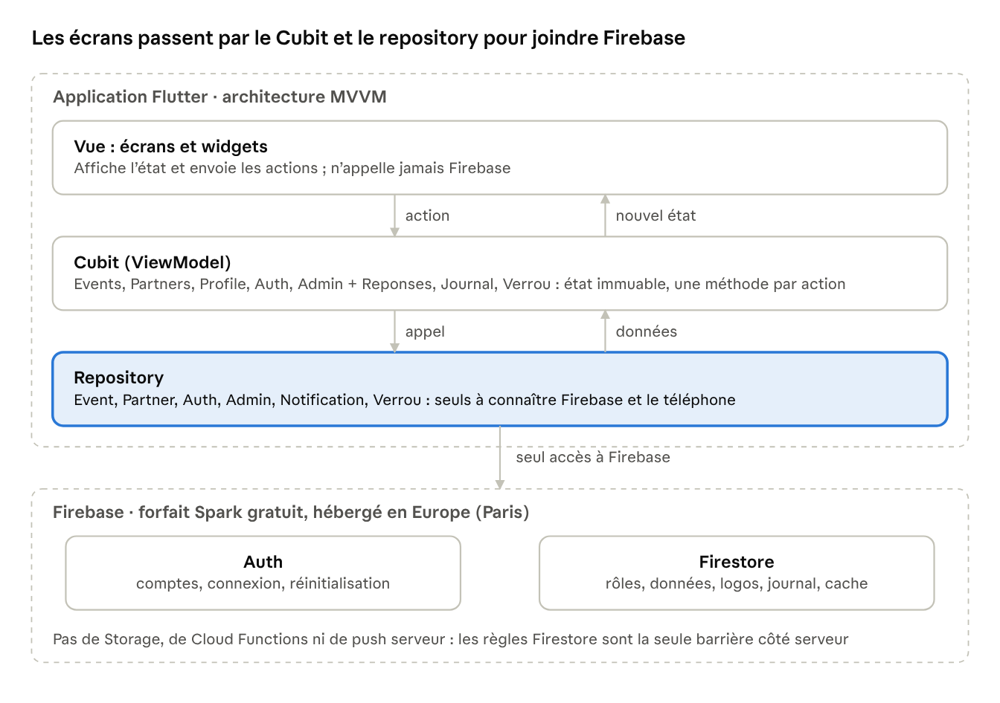

# Cahier des charges — Application partenaires du club de basket

Version finale · 18 novembre 2026 · FRANC — copie du document de référence (doc Claude), à mettre à jour avec lui.

L'application remplace le fichier de contacts et les mails du bureau par trois choses : un annuaire public des partenaires tenu à jour par les partenaires eux-mêmes, des événements avec réponse en un clic, et un rappel 2 jours avant sur le téléphone du partenaire. Seul le bureau crée les comptes, mais l'annuaire se consulte sans compte.

Cette version fusionne les deux cahiers des charges (v1 de Gaëlle et version de FRANC) selon les choix validés par le groupe le 17 novembre 2026. Ces choix sont résumés en annexe.

## 1. Contexte et besoins

Le club est géré à la main par deux bénévoles du bureau, avec un fichier de contacts, des mails et des messages. Les coordonnées des partenaires sont souvent périmées, et les invitations aux soirées, aux matchs en loge et aux afterworks se perdent. Le club veut donner de la visibilité à ses partenaires et leur permettre de se trouver entre eux.

### Les utilisateurs

| Profil | Qui | Ce qu'il fait dans l'app | Contrainte principale |
| --- | --- | --- | --- |
| Bureau (administrateur) | 1 ou 2 bénévoles, chacun avec son compte | Crée, désactive et supprime les comptes partenaires ; crée et modifie les événements ; voit les réponses | Pas informaticien, téléphone uniquement, peu de temps |
| Partenaire | Chefs d'entreprise, commerçants, artisans ; compte créé par le bureau | Tient sa fiche à jour, consulte l'annuaire, répond aux invitations | Pressé, iPhone ou Android, aucun mode d'emploi |
| Visiteur | Communauté du club, public ; aucun compte | Consulte l'annuaire et les fiches, en lecture seule | Aucune donnée collectée |

### Problèmes actuels et réponse de l'application

| Problème aujourd'hui | Ce que l'application apporte |
| --- | --- |
| Coordonnées jamais à jour (numéro, logo, adresse) | Chaque partenaire modifie lui-même sa fiche, sans passer par un bénévole |
| Partenaires peu visibles hors des panneaux | Annuaire public consultable sans compte, une fiche vitrine par partenaire : logo, activité, description, contacts pro |
| Les partenaires ne se connaissent pas (cas de l'expert-comptable) | Recherche par nom, métier et ville, filtre par secteur, boutons Appeler, E-mail, Site et Itinéraire |
| Invitations perdues dans les mails | Événements dans l'app, mis à jour en temps réel |
| Le bureau ne sait pas combien viendront | Réponse « Je viens / Je ne viens pas » avec nombre de personnes, total visible par le bureau |
| Changement de date ou de lieu mal relayé | Statut « modifié » ou « annulé » affiché dans l'app dès son ouverture (push automatique en évolution, F14) |
| Pas de rappel | Rappel local 2 jours avant l'événement pour ceux qui viennent |
| Réseau très faible au gymnase | Données gardées en cache local : l'app reste consultable hors ligne |

## 2. Fonctionnalités par priorité

Le périmètre P1 suffit à la démonstration et répond à tous les problèmes du club. P2 et P3 ne sont faits que si le temps le permet.

- **P1 — Indispensable** : sans elle, l'app ne répond pas au besoin.
- **P2 — Important** : forte valeur, faible coût.
- **P3 — Évolution** : hors périmètre du projet, citée pour montrer la suite.

| Id | Fonctionnalité | Qui | Priorité |
| --- | --- | --- | --- |
| F1 | Connexion par e-mail et mot de passe (pas d'inscription libre) | Bureau, partenaires | P1 |
| F2 | Mot de passe oublié : lien de réinitialisation par e-mail ; le bureau peut aussi déclencher l'envoi du lien, sans jamais voir de mot de passe | Bureau, partenaires | P1 |
| F3 | Créer un compte partenaire (nom de l'entreprise et e-mail) ; le partenaire reçoit un e-mail pour choisir son mot de passe | Bureau | P1 |
| F4 | Désactiver un compte immédiatement (compte volé, partenariat suspendu) | Bureau | P1 |
| F5 | Supprimer un partenaire et toutes ses données (son compte de connexion est ensuite supprimé dans la console Firebase) | Bureau | P1 |
| F6 | Modifier sa fiche : logo de l'entreprise, activité (métier), secteur (artisanat, services, restauration, autre), description, adresse, ville, téléphone pro, e-mail, site web | Partenaire | P1 |
| F7 | Téléphone personnel facultatif, visible seulement par le bureau | Partenaire | P1 |
| F8 | Annuaire public, consultable sans compte, avec recherche par nom, métier et ville, et filtre par secteur | Tous, visiteurs compris | P1 |
| F9 | Fiche détail avec boutons Appeler, E-mail, Site web, Itinéraire (ouvrent les apps du téléphone) | Tous, visiteurs compris | P1 |
| F10 | Créer, modifier, annuler un événement (titre, type, date, heure, lieu, description) | Bureau | P1 |
| F11 | Liste des événements à venir et détail | Comptes connectés | P1 |
| F12 | Répondre à une invitation : Je viens / Je ne viens pas et nombre de personnes (1 à 10) | Partenaire | P1 |
| F13 | Total des participants par événement et liste des réponses (pour le traiteur) | Bureau | P1 |
| F14 | Notification push à la création, à la modification ou à l'annulation d'un événement (demande le forfait Blaze, voir partie 3) | Partenaire | P3 |
| F15 | Consultation hors ligne de l'annuaire et des événements déjà vus | Tous | P1 |
| F16 | Rappel local 2 jours avant un événement auquel on a répondu « Je viens » | Partenaire | P2 |
| F17 | Verrouillage biométrique (empreinte ou visage) à l'ouverture du compte bureau | Bureau | P2 |
| F18 | Journal des actions du bureau (qui a créé, modifié, désactivé ou supprimé quoi) | Bureau | P2 |
| F19 | Événements publics (matchs ouverts) visibles sans compte, grâce à un champ public sur l'événement | Visiteurs | P3 |
| F20 | Mode sombre | Tous | P3 |
| F21 | Ajouter l'événement au calendrier du téléphone | Partenaire | P3 |
| F22 | Double authentification (code par SMS) pour le bureau | Bureau | P3 |

Volontairement exclus, car ils compliquent l'app sans répondre à un problème du club :

- **Messagerie entre partenaires** : il faudrait modérer et gérer plus de données. L'annuaire et le bouton Appeler suffisent pour que les partenaires se trouvent.
- **Statistiques de consultation des fiches** : elles demanderaient un consentement et un bandeau, alors que l'app n'a aucun traceur.
- **Photos de personnes** : la fiche n'accepte que le logo de l'entreprise (voir partie 5).
- **Fil d'actualité, paiement, billetterie**.

## 3. Plateformes cibles et technologies

Cible : Android 9 et plus, iOS 15 et plus, téléphone en mode portrait. L'app est faite avec **Flutter** (Dart), et **Firebase** sert de serveur.

### Pourquoi les deux plateformes

Les partenaires ont des iPhone et des Android, et le bureau doit pouvoir gérer depuis n'importe lequel. Choisir une cible est d'abord une décision business (cours 1) : ignorer une plateforme exclurait une partie des partenaires.

Android 9 minimum (minSdk 28) : le verrouillage biométrique (local\_auth) plante sous Android 8 avec le thème par défaut. Ces versions sont devenues très rares ; c'est un choix de cible assumé, donc une décision business (cours 1).

### Pourquoi Flutter

| Approche (cours 4) | Verdict pour ce projet |
| --- | --- |
| Natif (Kotlin + Swift) | Écarté : deux bases de code à écrire et maintenir pour une petite équipe |
| **Cross-platform Flutter** | **Retenu** : un seul code Dart, performances proches du natif, Material 3 intégré, plugins pour notifications, photos, biométrie |
| Cross-platform .NET MAUI | Écarté : adapté à une équipe .NET existante, ce qui n'est pas notre cas |
| Hybride (Ionic, Cordova) | Écarté : performances et ressenti limités |
| PWA | Écarté : accès limité aux fonctions du téléphone, notifications peu fiables sur iPhone |

Notre besoin d'accès natif est faible (notifications, galerie photo, biométrie) et couvert par des plugins officiels ou très répandus.

### Pourquoi Firebase plutôt qu'un serveur maison

Le club n'a personne pour maintenir un serveur. Firebase fournit les briques nécessaires sans serveur à gérer :

| Service Firebase | Rôle dans l'app |
| --- | --- |
| Authentication | Comptes e-mail et mot de passe, e-mail de réinitialisation (sert aussi d'invitation) |
| Cloud Firestore | Base de données (rôles, partenaires et leurs logos, événements, réponses, journal), cache hors ligne intégré |

Les données sont hébergées en Europe (région europe-west9, Paris) pour le RGPD. Le projet reste sur le forfait gratuit **Spark**, sans carte bancaire : il n'a donc ni Cloud Functions ni Storage. Les actions du bureau (créer, désactiver, supprimer un compte, tenir le journal) sont faites depuis son téléphone et vérifiées par les règles Firestore, et les logos sont rangés dans les fiches.

La seule fonction perdue est le push envoyé par un serveur (F14) : elle passe en évolution, car elle demande le forfait Blaze et une carte bancaire, même si le volume d'un club resterait dans les quotas gratuits.

### Paquets Flutter utilisés

| Paquet | Usage |
| --- | --- |
| firebase\_core, firebase\_auth, cloud\_firestore | Accès à Firebase |
| flutter\_bloc | Gestion d'état (Cubit) |
| image\_picker | Choisir le logo dans la galerie, via le sélecteur système |
| url\_launcher | Boutons Appeler, E-mail, Site, Itinéraire |
| flutter\_local\_notifications | Rappel 2 jours avant (P2) |
| local\_auth | Verrouillage biométrique du bureau (P2) |
| flutter\_secure\_storage | Préférence de verrouillage, rangée dans Keystore et Keychain (P2) |

La liste est volontairement courte : chaque paquet ajouté est une dépendance de plus à justifier (OWASP M2, chaîne d'approvisionnement).

## 4. Architecture

Le code suit l'architecture MVVM, avec un **Cubit** (paquet flutter\_bloc) dans le rôle du ViewModel. Côté serveur, tout repose sur Firebase, et le cache Firestore sert de source affichée quand il n'y a pas de réseau.



Le flux est à sens unique : l'écran envoie une action au Cubit, qui appelle le repository, seul à parler à Firebase ; le nouvel état remonte vers l'écran.

### Architecture du code

| Couche | Contenu | Règle |
| --- | --- | --- |
| Vue | Widgets, écrans | Affiche l'état, n'appelle jamais Firebase |
| Cubit | `EventsCubit`, `PartnersCubit`, `ProfileCubit`, `AuthCubit`, `AdminCubit`, et trois Cubits d'écran du bureau : `ReponsesCubit` (réponses à un événement), `JournalCubit` (journal des actions), `VerrouCubit` (verrou biométrique) | Expose un état immuable, une méthode par action |
| Repository | `EventRepository`, `PartnerRepository`, `AuthRepository`, `AdminRepository`, `NotificationRepository` (rappels locaux), `VerrouRepository` (biométrie et Keystore / Keychain) | Seul à connaître Firebase ; injecté dans le Cubit |
| Modèles | `Partner`, `Event`, `EventResponse`, `Session`, `Compte`, `ReponseBureau`, `EntreeJournal` | Classes immuables (champs `final`, constructeur `const`) ; une modification crée un nouvel objet |

Pourquoi Cubit : c'est l'équivalent direct du ViewModel du cours (un état et des méthodes), plus simple que BLoC (pas de classes d'événements) et testable sans émulateur. `setState` reste utilisé pour l'état purement local d'un widget (champ de saisie).

Les 4 états d'un écran sont un type somme. Le `switch` de la vue doit couvrir tous les cas, sinon le code ne compile pas :

```dart
// lib/features/events/logic/events_state.dart
sealed class EventsState { const EventsState(); }

class EventsLoading extends EventsState { const EventsLoading(); }

class EventsError extends EventsState {
  const EventsError(this.message);
  final String message;
}

class EventsEmpty extends EventsState {
  const EventsEmpty({this.horsLigne = false, this.derniereSynchro});
  final bool horsLigne;
  final DateTime? derniereSynchro;
}

class EventsSuccess extends EventsState {
  const EventsSuccess({required this.evenements, this.reponses = const {}, this.horsLigne = false, this.derniereSynchro});
  final List<Event> evenements;
  final Map<String, EventResponse> reponses; // mes réponses, par événement
  final bool horsLigne;                      // données venues du cache : bandeau « Hors connexion »
  final DateTime? derniereSynchro;
}

// Dans la vue : le switch couvre les 4 cas, sinon le code ne compile pas.
switch (state) {
  EventsLoading() => const CircularProgressIndicator(),
  EventsError(:final message) => _Erreur(message),       // avec un bouton Réessayer
  EventsEmpty() => const Text('Aucun événement à venir'),
  EventsSuccess() => _Agenda(state),
}
```

Organisation des dossiers, par fonctionnalité :

```text
lib/
  core/
    theme/app_theme.dart          seul fichier de couleurs et de polices
    navigation/onglets_page.dart  onglets selon le rôle
    widgets/                      bandeau « Hors connexion »
    format_date.dart, confidentialite_page.dart
  features/
    auth/           data/ (repository, Session)  logic/ (Cubit + états)  ui/ (écrans)
    partners/       data/  logic/  ui/           annuaire, fiche, Mon profil
    events/         data/  logic/  ui/           agenda, détail, « Je viens »
    admin/          data/  logic/  ui/           comptes, événements du bureau, journal, verrou
    notifications/  data/                        rappels locaux (pas d'écran propre)
  firebase_options.dart           généré par flutterfire configure
  main.dart                       injection des repositories et des Cubits
test/
  fake_*_repository.dart          faux repositories (implements du vrai)
  features/…/*_cubit_test.dart    un fichier de test par Cubit
  widget_test.dart                parcours complets
firestore.rules                   règles déployées sur Firebase
```

Navigation : `Navigator` standard (pile d'écrans) sous une `NavigationBar`. L'identifiant du partenaire ou de l'événement voyage avec la navigation, et l'écran de détail relit la donnée dans le Cubit partagé. Les onglets sont calculés à partir de la session : un visiteur a Club, Annuaire et Connexion ; un partenaire Annuaire, Événements et Mon profil ; le bureau a en plus Administration. Un écran de lancement s'affiche le temps de lire la session. À chaque connexion ou déconnexion, l'app repart de zéro (pile vidée, Cubits du compte recréés) : un compte ne voit jamais les données du précédent.

Tests (cours 6) : 75 tests, lancés par la CI GitHub Actions à chaque pull request. Un fichier par Cubit (Auth, Partners, Profile, Events, Admin avec Réponses et Journal, Verrou), chacun avec un faux repository qui fait `implements` du vrai : ni émulateur ni Firebase, en Arrange, Act, Assert. Les tests widget suivent les parcours complets, dont le parcours principal « ouvrir un événement et répondre Je viens » hors ligne puis synchronisé.

### Les données

L'identifiant d'une fiche partenaire est celui du compte du partenaire (uid). La règle « un partenaire ne modifie que sa fiche » se réduit donc à une comparaison.

| Collection Firestore | Champs principaux | Qui lit | Qui écrit |
| --- | --- | --- | --- |
| `users/{uid}` | email, role (admin ou partenaire), disabled | Lui-même, bureau | Bureau uniquement, jamais son propre profil |
| `partners/{uid}` | nom, métier, secteur, description, ville, adresse, téléphone pro, e-mail, site, logo (image de 256 px, 150 Ko au plus), updatedAt | Tout le monde, visiteurs compris | Le partenaire concerné, bureau |
| `partners/{uid}/private/contact` | téléphone personnel | Le partenaire concerné, bureau | Le partenaire concerné |
| `events/{id}` | titre, type, date, lieu, description, statut (prévu, modifié, annulé) | Comptes connectés | Bureau |
| `events/{id}/responses/{uid}` | vient (oui/non), nbPersonnes (0 à 10, vérifié par les règles), updatedAt | Le partenaire concerné, bureau | Le partenaire concerné |
| `adminLogs/{id}` (P2) | auteur, action, cible, date | Bureau | Bureau, dans le même lot que l'action ; jamais modifié |

Le rôle (`admin` ou `partenaire`) est rangé dans `users/{uid}`. Les règles interdisent à chacun de modifier son propre profil : seul un autre membre du bureau peut donner un rôle ou désactiver un compte. Le premier compte du bureau est créé à la main dans la console Firebase.

### Règles d'accès Firestore

Les droits sont vérifiés par le serveur, pas par l'app. Un compte désactivé perd ses droits tout de suite grâce au champ `disabled`, sans attendre l'expiration de sa session.

```text
rules_version = '2';
// Copie de firestore.rules (dépôt ParquetClub). Forfait Spark : ces règles sont la seule barrière côté serveur.
// Le rôle et l'état actif sont lus dans users/{uid}, que seul le bureau peut écrire.
service cloud.firestore {
  match /databases/{database}/documents {
    function signedIn() { return request.auth != null; }
    function profil() { return get(/databases/$(database)/documents/users/$(request.auth.uid)).data; }
    // Un compte désactivé perd ses droits tout de suite, sans attendre la fin de sa session (F4).
    function active() {
      return signedIn()
        && exists(/databases/$(database)/documents/users/$(request.auth.uid))
        && profil().get('disabled', false) == false;
    }
    function isAdmin() { return active() && profil().role == 'admin'; }
    function isOwner(id) { return active() && request.auth.uid == id; }

    // OWASP M4 : mêmes contrôles que l'app (longueurs, https), refaits ici car l'app peut être contournée.
    function texte(v, max) { return v is string && v.size() <= max; }

    match /users/{uid} {
      allow read: if isOwner(uid) || isAdmin();
      // Seul le bureau écrit les profils, jamais le sien : un partenaire ne peut pas se donner le rôle admin,
      // et un bénévole ne peut pas se désactiver ou se rétrograder par erreur.
      allow create, update: if isAdmin() && uid != request.auth.uid
        && request.resource.data.keys().hasOnly(['email', 'role', 'disabled'])
        && texte(request.resource.data.email, 254)
        && request.resource.data.role in ['admin', 'partenaire']
        && request.resource.data.disabled is bool;
      allow delete: if isAdmin() && uid != request.auth.uid;
    }

    function ficheValide(d) {
      return d.keys().hasOnly(['nom', 'metier', 'secteur', 'description', 'adresse', 'ville',
                               'telephone', 'email', 'site', 'logo', 'updatedAt'])
        && texte(d.nom, 80) && d.nom.size() > 0
        && texte(d.metier, 60)
        && d.secteur in ['Artisanat', 'Services', 'Restauration', 'Autre']
        && texte(d.description, 1000)
        && texte(d.adresse, 120)
        && texte(d.ville, 60)
        && texte(d.telephone, 20)
        && texte(d.email, 254)
        && texte(d.site, 200) && (d.site == '' || d.site.matches('https://.+'))
        // Logo rangé dans la fiche (pas de Storage sur Spark) : une image, 150 Ko au plus.
        && (!('logo' in d) || (d.logo is bytes && d.logo.size() <= 150000));
    }

    match /partners/{id} {
      allow read: if true;                       // annuaire public (F8)
      allow create: if isAdmin() && ficheValide(request.resource.data);      // F3
      allow update: if (isOwner(id) || isAdmin()) && ficheValide(request.resource.data);
      allow delete: if isAdmin();                // F5

      match /private/{doc} {                     // téléphone personnel (F7)
        allow read: if isOwner(id) || isAdmin();
        allow write: if isOwner(id) && doc == 'contact'
          && request.resource.data.keys().hasOnly(['telephonePerso'])
          && texte(request.resource.data.telephonePerso, 20);
        allow delete: if isAdmin();              // F5
      }
    }

    match /adminLogs/{id} {                      // journal (F18)
      allow read: if isAdmin();
      // Écrit par le bureau, dans le même lot que l'action ; l'auteur est forcément le compte connecté.
      // Jamais modifié ni effacé.
      allow create: if isAdmin()
        && request.resource.data.keys().hasOnly(['auteur', 'auteurEmail', 'action', 'cible', 'date'])
        && request.resource.data.auteur == request.auth.uid
        && request.resource.data.date == request.time
        && texte(request.resource.data.action, 80)
        && texte(request.resource.data.cible, 120);
    }

    match /events/{eventId} {
      allow read: if active();                   // réservé aux comptes connectés
      allow write: if isAdmin();

      match /responses/{uid} {
        allow read: if isOwner(uid) || isAdmin();
        // OWASP M4 : forme de la réponse vérifiée ; pas de réponse à un événement annulé.
        allow create, update: if isOwner(uid)
          && request.resource.data.keys().hasOnly(['vient', 'nbPersonnes', 'updatedAt'])
          && request.resource.data.vient is bool
          && request.resource.data.nbPersonnes is int
          && request.resource.data.nbPersonnes >= 0
          && request.resource.data.nbPersonnes <= 10
          && get(/databases/$(database)/documents/events/$(eventId)).data.statut != 'annule';
        allow delete: if isAdmin();              // suppression d'un partenaire (F5), purge à 12 mois (RGPD)
      }
    }
  }
}
```

Sans Storage, le logo est rangé dans la fiche elle-même (champ `logo`) : lisible par tous comme la fiche, modifiable par le partenaire concerné ou le bureau. Il est réduit à 256 px avant l'envoi et les règles refusent plus de 150 Ko, ce qui règle aussi le problème des logos au mauvais format. Il reste visible hors ligne, avec le reste de la fiche.

### Hors ligne (gymnase)

- Le cache local de Firestore est activé par défaut sur mobile : l'annuaire et les événements déjà consultés s'affichent sans réseau.
- Une réponse « Je viens » faite hors ligne est écrite dans le cache, affichée tout de suite, puis envoyée au retour du réseau.
- Les écrans écoutent Firestore en temps réel : une modification d'événement apparaît dès que le réseau revient.
- Quand les données viennent du cache, l'écran affiche un bandeau discret « Hors connexion — données du … » au lieu d'un chargement sans fin. Les logos, rangés dans les fiches, restent visibles.

### Notifications

1. Forfait Spark : aucun serveur pour envoyer un push. Les événements s'affichent en temps réel dans l'onglet Événements dès que l'app est ouverte, avec leur statut « modifié » ou « annulé ».
2. Rappel 2 jours avant (P2) : quand le partenaire répond « Je viens », l'app programme une notification locale. Elle est déprogrammée s'il change d'avis ou si l'événement est annulé, et reprogrammée si la date change. C'est l'EventsCubit qui recalcule les rappels à chaque changement.
3. Au premier « Je viens », l'app explique le rappel, puis demande l'autorisation des notifications : au moment où elle sert. Un refus n'empêche rien d'autre.
4. Un appui sur le rappel ouvre le détail de l'événement.
5. À la déconnexion, l'AuthCubit retire tous les rappels du compte : le suivant sur ce téléphone ne reçoit rien.
6. Évolution (F14, forfait Blaze) : une Cloud Function déclenchée par l'écriture d'un événement enverrait un push FCM à tous les partenaires, même app fermée, avec un texte généré par le serveur.

## 5. Sécurité et données personnelles

Principe directeur : les droits sont vérifiés côté serveur (règles Firestore, seule barrière côté serveur sur le forfait Spark), jamais seulement dans l'app. Masquer un bouton ne protège rien (OWASP M3).

### Authentification

- **Pas d'inscription libre.** Le bureau crée le compte depuis son téléphone, avec un mot de passe aléatoire jamais affiché ; les règles n'acceptent le profil et la fiche que d'un administrateur. Les visiteurs n'ont pas de compte.
- **Transmission des identifiants** : aucun mot de passe ne circule par SMS ou par mail. Le partenaire reçoit un lien Firebase pour choisir lui-même son mot de passe.
- **Mot de passe oublié** : bouton sur l'écran de connexion, Firebase envoie un lien de réinitialisation. Si le partenaire est perdu, le bureau peut déclencher l'envoi du même lien. Personne ne voit jamais le mot de passe.
- **Rôles** : chaque compte a un rôle `admin` ou `partenaire`, rangé dans `users/{uid}`. Personne ne peut modifier son propre profil : le partenaire ne peut pas se l'attribuer.
- **Désactivation** : le bureau désactive un compte en un clic (`disabled` à vrai). Les règles refusent aussitôt toute lecture et écriture, et l'app déconnecte le compte dès qu'elle voit le changement. Sans Cloud Functions, la connexion elle-même n'est pas bloquée, mais elle ne donne plus accès à rien.
- **Mots de passe** : jamais stockés par l'app ; Firebase les conserve hachés. La session est gérée par le SDK Firebase Auth.

### Réponse aux inquiétudes du club

| Inquiétude | Réponse technique |
| --- | --- |
| Le compte d'un bénévole est volé | L'autre bénévole désactive le compte immédiatement (F4). Seul un admin écrit les événements. Verrouillage biométrique à l'ouverture (P2). Journal des actions pour voir et corriger (P2). Double authentification en évolution (P3). |
| Numéro personnel visible par tous | Rangé dans un document séparé (`partners/{uid}/private/contact`), lisible seulement par le partenaire et le bureau. Les règles Firestore filtrent par document, pas par champ : d'où ce document à part, même si la fiche est publique. |
| Un partenaire part et demande la suppression | Le bureau clique « Supprimer le partenaire » : l'app efface la fiche, le logo, le numéro privé et les réponses aux événements, puis le bureau supprime le compte de connexion dans la console Firebase. Délai légal : 1 mois maximum. |
| Mot de passe oublié | Lien de réinitialisation par e-mail, en autonomie ou déclenché par le bureau (F2). |
| Un partenaire modifie la fiche d'un autre | Règle : on ne modifie une fiche que si son identifiant est celui du compte connecté, ou si l'on est admin. |
| Invitation envoyée au mauvais destinataire | Pas d'envoi à un destinataire : les événements ne sont lisibles que par les comptes actifs, dans l'app. Un compte désactivé ou supprimé n'y a plus accès. |

### Image de la fiche : le logo uniquement

Chaque fiche n'a qu'une image : le logo de l'entreprise. Le champ s'appelle « Logo de l'entreprise » et un rappel sous le bouton indique qu'il ne faut pas mettre de photo de personne.

Une photo où une personne est reconnaissable est une donnée personnelle (RGPD) et demande son accord (droit à l'image). En se limitant au logo, l'app n'a ni consentement ni droit à l'image à gérer. Si un partenaire met quand même sa photo, c'est sous sa responsabilité, et elle est effacée à son départ avec le reste de la fiche.

### Stockage des données sensibles

- Sur le téléphone : seulement le cache Firestore (données déjà visibles dans l'app). Pas de mot de passe, pas de clé secrète.
- Si l'app doit garder un secret à elle (préférence de verrouillage), il va dans `flutter_secure_storage`, donc Keystore (Android) et Keychain (iOS), jamais dans `shared_preferences` (OWASP M9).
- Aucun secret en dur dans le code. La configuration Firebase n'est pas un secret : la protection repose sur les règles serveur. Les clés de signature restent hors du dépôt Git (`.gitignore`).
- Communications en HTTPS uniquement (natif dans les SDK Firebase, OWASP M5).

### Permissions demandées

Moindre privilège (OWASP M6) : une seule permission demandée pendant l'utilisation, au moment où elle sert, avec une phrase d'explication avant la fenêtre du système.

| Permission | Android | iOS | Quand | Si refus |
| --- | --- | --- | --- | --- |
| Notifications | POST\_NOTIFICATIONS (Android 13+) | requestAuthorization | Au premier « Je viens » d'un partenaire, avec l'explication « un rappel 2 jours avant » | L'app fonctionne ; seul le rappel manque |
| Galerie photo | Aucune : sélecteur photo système | Aucune : PHPicker | Au choix du logo | — |

Non demandées : localisation (l'adresse est saisie au clavier, l'itinéraire ouvre l'app Plans), caméra, contacts. Les visiteurs ne voient aucune demande de permission.

### Risques identifiés (OWASP Mobile Top 10 2024)

| Code | Risque pour nous | Contre-mesure |
| --- | --- | --- |
| M3 | Un partenaire ou un visiteur agit comme admin | Rôles vérifiés par les règles Firestore (personne ne modifie son propre profil) ; un compte désactivé perd ses droits aussitôt |
| M4 | Texte ou lien malveillant dans une fiche publique | Longueurs limitées, URL vérifiées (https), texte affiché comme texte |
| M5 | Interception réseau | HTTPS imposé par Firebase |
| M6 | Collecte excessive, données exposées par l'annuaire public | Seules les infos pro choisies par le partenaire sont publiques ; numéro privé cloisonné ; pas de localisation, pas d'analytics, aucune donnée sur les visiteurs |
| M8 | Mauvaise configuration | Version publiée : logs supprimés, mode debug désactivé, sauvegarde Android exclue |
| M9 | Données lisibles sur l'appareil | Rien de secret en clair ; Keystore et Keychain si besoin |

### RGPD

| Notion | Application dans le projet |
| --- | --- |
| Données collectées | Nom et e-mail du compte, informations professionnelles de la fiche, logo, téléphone personnel facultatif, réponses aux événements. Rien sur les visiteurs |
| Base légale | Exécution du contrat de partenariat (visibilité dans l'annuaire public, invitations). Le partenaire est informé à la création du compte que sa fiche est publique |
| Minimisation | Pas de localisation, pas de date de naissance, pas de photo de personne, pas de traceur publicitaire ni d'analytics : aucun bandeau de consentement nécessaire |
| Privacy by design | Téléphone personnel masqué par défaut ; données hébergées dans l'UE |
| Durée de conservation | Tant que le partenariat est actif ; tout est effacé de l'app à la fin. Les réponses aux événements sont effacées 12 mois après l'événement. Le contrat et les factures restent dans la comptabilité du club, hors de l'app |
| Droits des personnes | Accès et rectification : le partenaire voit et modifie sa fiche. Effacement : bouton de suppression côté bureau, délai 1 mois maximum. Réclamation possible auprès de la CNIL |
| Responsable du traitement | Le club (son président) ; Google Firebase est sous-traitant |
| Politique de confidentialité | Lien dans l'app (écran Profil et bas de l'annuaire, pour les visiteurs) et dans les fiches des stores |

## 6. Identité visuelle et ergonomie

Les trois couleurs du club sont validées : rouge `#E30613`, noir `#000000` et blanc `#FFFFFF`. La place de chaque couleur dans les barres du haut et du bas sera fixée par la maquette du groupe, à venir.

Les couleurs vivent dans un seul fichier de thème (`lib/core/theme/app_theme.dart`) : les écrans les lisent, ils ne les répètent jamais (cours 5). Changer la disposition après la maquette ne touchera donc que ce fichier.

### Couleurs et contraste (WCAG AA : 4,5 pour 1 minimum pour le texte courant, 3 pour 1 pour une icône)

| Combinaison | Contraste | Usage |
| --- | --- | --- |
| Texte noir sur blanc | 21 pour 1 — conforme | Texte courant |
| Texte blanc sur noir | 21 pour 1 — conforme | Libellés sur une barre noire |
| Texte blanc sur rouge | 4,9 pour 1 — conforme | Boutons principaux, barre rouge |
| Texte rouge sur blanc | 4,9 pour 1 — conforme | Liens, accents |
| Icône rouge sur noir | 4,3 pour 1 — conforme pour une icône | Onglet actif sur une barre noire |
| Texte noir sur rouge, ou rouge sur noir | 4,3 pour 1 — refusé | Interdit pour du texte |

Thème Material 3 : `ColorScheme` avec `primary` = #E30613, `onPrimary` = #FFFFFF, `surface` = #FFFFFF, `onSurface` = #000000.

### Ergonomie (cours 5)

- **Navigation en bas** (zone du pouce). Un visiteur arrive d'abord sur un écran d'accueil du club (logo, courte présentation, boutons « Voir les partenaires » et « Se connecter »), puis voit l'annuaire. Un compte connecté arrive directement sur ses onglets. Un partenaire a 3 onglets : Annuaire, Événements, Mon profil. Le bureau a un 4e onglet : Administration.
- **Action principale en bas** et pleine largeur : « Je viens », « Enregistrer », « Créer l'événement ».
- **Actions destructrices loin du pouce et confirmées** : supprimer ou désactiver un partenaire, annuler un événement, se déconnecter.
- **Accessibilité** : texte qui suit la taille système, cibles tactiles de 48 dp minimum, logos et icônes avec un libellé pour le lecteur d'écran.
- **4 états sur chaque écran réseau** : chargement, erreur (avec bouton Réessayer), vide (« Aucun événement à venir »), succès.
- **Hors ligne visible** : un bandeau discret « Hors connexion — données du … » plutôt qu'un rond de chargement sans fin.
- **Formulaire de fiche lisible** : un champ par ligne, libellé au-dessus, clavier adapté (téléphone, e-mail, URL).

## Annexe A — Choix arbitrés entre les deux versions

Le détail des raisons est dans la [feuille des choix validés](https://claude.ai/artifact/RfxbGtqdjsiTZbvANsNSSZ).

| Sujet | Décision | Repris de |
| --- | --- | --- |
| Annuaire et fiches | Publics, lisibles sans compte | v1 |
| Événements | Réservés aux comptes connectés ; événements publics en P3 | FRANC, v1 en P3 |
| Nombre de participants | P1, avec nombre de personnes et total pour le bureau | FRANC |
| Hors ligne | P1, grâce au cache Firestore | FRANC |
| Rappel | P2, notification locale 2 jours avant pour ceux qui viennent | FRANC |
| Téléphone | Pro public, perso visible seulement par le bureau | FRANC |
| Mot de passe oublié | Lien par e-mail ; le bureau peut déclencher l'envoi | Fusion |
| Compte piraté | Mesures de FRANC et bouton « Désactiver le compte » | Fusion |
| Messagerie, statistiques | Exclues | FRANC |
| Départ d'un partenaire | Tout effacé sous 1 mois ; contrat et factures dans la comptabilité du club | Fusion |
| Image de la fiche | Logo de l'entreprise uniquement, sans permission | FRANC, précisé par le groupe |
| Recherche | Par nom, métier et ville, filtre par secteur | FRANC |
| Couleurs | Rouge, noir, blanc validés ; disposition selon la maquette | Fusion |

## Annexe B — Questions probables du jury

Réponses courtes que chaque membre du groupe doit savoir donner, avec le cours d'origine.

| Question | Réponse attendue | Cours |
| --- | --- | --- |
| Pourquoi Flutter et pas du natif ? | Un seul code pour iOS et Android, petite équipe, besoin natif faible et couvert par des plugins | 4 |
| Pourquoi Cubit et pas BLoC ? | Cubit = on appelle une méthode, BLoC = on envoie un événement. Nos actions sont simples : les événements n'apporteraient que du code en plus. Même paquet, même testabilité | 4 |
| Pourquoi pas setState partout ? | La liste des événements est partagée par plusieurs écrans : un état partagé doit sortir du widget. setState reste utilisé pour l'état purement local | 1, 4 |
| Quel est le lien entre Cubit et MVVM ? | Le Cubit joue le rôle du ViewModel : il expose l'état, la vue l'affiche, le repository fournit les données | 1, 2, 4 |
| Que sont les 4 états d'un écran ? | Chargement, erreur, vide, succès, modélisés par une sealed class et traités par un switch exhaustif | 1, 4 |
| Pourquoi l'annuaire est-il public ? | Le but du club est la visibilité des partenaires. La fiche ne contient que des infos pro, choisies par le partenaire ; le numéro perso est dans un document séparé | 6 |
| Que se passe-t-il au gymnase sans réseau ? | Firestore lit son cache local, l'écran affiche les dernières données ; une réponse « Je viens » est mise en file et envoyée au retour du réseau | 1 |
| Que se passe-t-il si l'app est tuée pendant la saisie d'une fiche ? | L'état vit dans le Cubit et les données enregistrées dans Firestore ; seule une saisie non validée est perdue | 1 |
| Différence notification locale / push ? | Locale : déclenchée par l'app (rappel). Push : envoyée par un serveur via FCM, arrive même app fermée. Sur le forfait Spark, seul le rappel local existe | 3 |
| Pourquoi le rappel est-il local ? | Il ne dépend que du téléphone : il part même sans réseau, et sans serveur | 3 |
| Pourquoi pas de notification push ? | Forfait Spark gratuit, sans carte : pas de Cloud Functions pour envoyer un push. Il demanderait le forfait Blaze (0 € au volume d'un club, mais une carte). Les événements restent visibles en temps réel dans l'app, et le rappel J-2 est local | 3, 6 |
| Comment protégez-vous le compte admin ? | Droits vérifiés côté serveur (règles Firestore, rôle dans un profil que personne ne modifie soi-même), biométrie à l'ouverture, journal des actions | 6 |
| Comment bloquer un compte volé ? | Le bureau le désactive : le champ disabled fait refuser toute lecture et écriture par les règles, sans attendre, et l'app déconnecte le compte | 6 |
| Que vaut une biométrie réussie ? | Seulement un « oui » local : elle verrouille l'app, elle ne remplace pas les règles serveur | 6 |
| Où stockez-vous un secret sur le téléphone ? | Keystore / Keychain via flutter\_secure\_storage, jamais shared\_preferences | 6 |
| La clé Firebase dans l'app, c'est un secret en dur ? | Non : elle identifie le projet, elle ne donne aucun droit. La sécurité repose sur les règles Firestore | 6 |
| Quelles permissions demandez-vous ? | Uniquement les notifications, au bon moment et avec explication ; la galerie passe par le sélecteur système | 3, 6 |
| Pourquoi seulement un logo et pas de photo ? | Une photo de personne est une donnée personnelle et demande son accord (droit à l'image). Le logo évite tout ça | 6 |
| Pourquoi pas de bandeau de consentement ? | Aucun traceur ni analytics, rien sur les visiteurs : la base légale est le contrat de partenariat | 6 |
| Comment cacher le numéro personnel ? | Document séparé, lisible seulement par son propriétaire et le bureau, car les règles Firestore filtrent par document | 6 |
| Pourquoi texte blanc sur rouge et pas noir ? | Blanc sur #E30613 = 4,9 pour 1 (conforme AA) ; noir sur rouge = 4,3 pour 1 (refusé) | 5 |
| Où sont les boutons importants ? | En bas, dans la zone du pouce ; les actions destructrices loin du pouce et confirmées | 5 |
